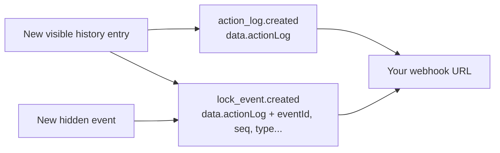

# Webhooks

Webhooks provide a way for Chaster to notify your extension when certain events occur, allowing your extension to take action in response to these events. In this guide, you'll learn how to configure and use webhooks in your Chaster extension.

## What are webhooks?

Webhooks are HTTP callbacks or HTTP POST requests that are triggered by specific events. When an event of interest occurs, Chaster sends an HTTP POST request to a URL that you specify, allowing your extension to receive and process the event data.

Webhooks are useful for various purposes, including:

- Keeping your extension in sync with Chaster data.
- Sending notifications or updates to your extension when specific events occur.
- Triggering actions or workflows in your extension based on Chaster events.

## Why to use webhooks?

Using webhooks in your Chaster extension enables real-time communication between Chaster and your extension, ensuring that your extension can respond to events promptly and accurately. Here are some reasons to use webhooks:

- **Real-time updates**: Webhooks provide instant notifications of events, allowing your extension to react immediately when something happens on Chaster.

- **Automation**: Webhooks enable automation by triggering actions or workflows in your extension in response to Chaster events, reducing manual intervention.

- **Better user experience**: With webhooks, you can provide a more interactive and dynamic experience for Chaster users by delivering timely information and updates.

## Configuring webhooks

To configure webhooks for your Chaster extension, follow these steps:

1. **Access Developer Interface**: Log in to Chaster and access the Developer Interface.

2. **Extension Settings**: Navigate to your extension settings within the Developer Interface.

3. **Extension URLs**: In the Extension URLs section, you'll find options to configure webhooks. Enter the URL where you want to receive webhook notifications for each event type. This URL should be publicly accessible over HTTPS.

4. **Basic Authentication**: If you want to protect your webhook URL with basic authentication, you can provide a username and password. We will include these credentials in the HTTP request to your webhook URL. These credentials are required for other extensions to call your commands and queries.

## Handling webhooks

### Responding to a request

When an event occurs, Chaster will send an HTTP POST request to the specified webhook URL. Upon receiving a webhook, your extension should promptly respond with an HTTP status code in the 2xx range (e.g., 200 OK) to acknowledge the receipt of the notification. This response serves as confirmation that your extension has successfully received the event data. Acknowledge only after accepting the event into your durable processing workflow. A 2xx response does not guarantee delivery of later events.

:::info
These rules apply to notifications. `action.invoke` is different: it is a call from another extension, and Chaster expects the result of the command in the response, within 10 seconds. It is never retried. See [Handling invocations](/api/extensions-api/extension-communication/handling-invocations).
:::

Chaster adds new event types over time. Read the `event` field first, and answer `2xx` to event types your extension does not handle: any other response triggers retries.

### Retries

Chaster employs a retry mechanism for webhook notifications to improve reliability. If the initial HTTP POST request to your webhook URL fails to receive a response within 10 seconds or encounters an error, Chaster will make up to four additional attempts. These retries use exponential backoff starting at 60 seconds (approximately 1, 2, 4 and 8 minutes). Each attempt has a new `requestId` and `sentAt`. Retries apply to queued notifications; they do not guarantee that every event is enqueued or delivered. Never deduplicate on `requestId`: use the id of the object the event carries, such as `data.eventId` for `lock_event.created`.

### Debugging

:::caution
The debug section is not available yet, but will be added soon.
:::

To assist you in monitoring webhook delivery and troubleshooting any potential issues, Chaster Developer Interface maintains a history of sent webhooks. This history includes details about the HTTP status codes of the responses your extension provided. You can access this information to review the webhook notifications sent by Chaster and to debug any problems that may arise during webhook handling.

Webhook history is kept for 7 days.

If you encounter difficulties, need guidance on webhook implementation, or require help with debugging webhook reception, don't hesitate to reach out to us.

## Event types

To determine which event types to monitor and configure webhooks for, consider the specific requirements of your extension. Here are the available event types:

- `extension_session.created`: Monitor this event to receive notifications when a new session is created. This can happen when a new lock is created with your extension enabled, or when your extension is enabled on a running lock.
- `extension_session.updated`: Monitor this event to receive notifications when an existing session is updated.
- `extension_session.deleted`: Monitor this event to receive notifications when a session is deleted.
- `peer_verification.ended`: Receive the terminal verdict for a standalone review created by your extension/session, with vote totals and criterion results.
- `action_log.created`: Monitor this event to receive notifications when a new action log entry is created, such as when a lock is unlocked, time is added, etc.
- `lock_event.created`: Receive the events of the locks where your extension is installed, with their sequence number, type and causation. See [Lock events](/api/extensions-api/extension-communication/lock-events).
- `action.invoke`: Receive calls from other extensions to your commands and queries, when your manifest has no `invokeUrl`. See [Handling invocations](/api/extensions-api/extension-communication/handling-invocations).

Choose the event types that are relevant to your extension functionality and use cases.

To know exactly the data that is sent with each event type, please refer to the [API documentation](https://api.chaster.app/api) and the model `WebhookEventForPublic`.

## Lock events and action logs

`action_log.created` and `lock_event.created` both carry history entries, and overlap:



| | `action_log.created` | `lock_event.created` |
| --- | --- | --- |
| Visible history entries | Yes | Yes, depending on subscriptions |
| Hidden events | No | Yes, depending on subscriptions |
| Entries created by your own extension | Yes | No, unless you subscribe to them |
| Entry | `data.actionLog` | `data.actionLog`, plus `eventId`, `seq`, `type`, `payload`, `source`, `correlationId`, `causationId` |

`data.actionLog` has the same format in both events, and `data.eventId` equals `data.actionLog._id`.

An extension without a [manifest](/api/extensions-api/extension-communication/manifest) receives `lock_event.created` for every event of the lock. A visible history entry then reaches it twice, once per event type.

:::warning
If your handler reacts to any webhook that contains `data.actionLog` without checking `event`, it reacts twice to each history entry, and also reacts to hidden events.

**To keep your current behavior**, handle only `action_log.created`. When `event` is `lock_event.created`, answer `2xx` and do nothing else.
:::

To move to `lock_event.created` instead:

1. Upload a [manifest](/api/extensions-api/extension-communication/manifest) whose `subscriptions` list the event types you need. Untyped entries such as custom logs are then no longer delivered as lock events.
2. Ignore `action_log.created`, or deduplicate on `data.actionLog._id` if you keep both.
3. If you changed the subscriptions of a session, they override the manifest for that session.


## Peer review verdicts

After a [standalone peer review](/api/extensions-api/create-your-extension/peer-verifications) completes through normal verdict processing, Chaster sends `peer_verification.ended` to the creating partner's configured callback URL. The payload identifies the creating session. Other extensions on the same lock do not receive it. Configure HTTPS and the existing basic authentication settings, and validate those credentials in your handler.

This complete synthetic envelope shows a rejected review:

```json
{
  "event": "peer_verification.ended",
  "sentAt": "2030-01-01T12:15:01.000Z",
  "requestId": "synthetic-attempt-01",
  "data": {
    "sessionId": "synthetic-session-01",
    "extension": {
      "slug": "synthetic-extension"
    },
    "lockId": "000000000000000000000401",
    "peerVerificationId": "000000000000000000000301",
    "verificationTypeKey": "photo",
    "status": "rejected",
    "endedAt": "2030-01-01T12:15:00.000Z",
    "voteCounts": {
      "verified": 2,
      "rejected": 1
    },
    "checkResults": [
      {
        "checkId": "seal-intact",
        "name": "generic",
        "checkIndex": 0,
        "subcheckName": "generic",
        "nbVerifiedVotes": 3,
        "nbRejectedVotes": 0,
        "rejectionReasons": []
      },
      {
        "checkId": "date-visible",
        "name": "generic",
        "checkIndex": 1,
        "subcheckName": "generic",
        "nbVerifiedVotes": 2,
        "nbRejectedVotes": 1,
        "rejectionReasons": [
          {
            "slug": "unclear",
            "text": "The date is unclear.",
            "nbVotes": 1
          }
        ]
      }
    ]
  }
}
```

`status` is `verified` or `rejected`. `endedAt` is the stored verdict time; `sentAt` is the time of this delivery attempt. `requestId` also changes on retry, so use it for attempt diagnostics, not business deduplication. The payload contains no image bytes, private URLs, attachment tokens or voter identities.

Deduplicate your durable partner work by `(data.peerVerificationId, event)`, for example `000000000000000000000301:peer_verification.ended`. After authenticating and validating the envelope, atomically accept that key and payload into your own durable inbox, then return a prompt 2xx acknowledgment. Process accepted work once according to your own storage/worker guarantees. Duplicate deliveries should receive a successful acknowledgment without repeating your business work. Do not mark work complete before it is durably accepted.

`checkResults` preserves `checkId`, family `name`, `checkIndex` and `subcheckName`, plus `nbVerifiedVotes`, `nbRejectedVotes` and reason `nbVotes`. This differs from history's criterion `approved`, `rejected` and reason `count` fields. Identical reason slugs in different criteria remain separate through `checkId` and stored reason text. No per-check verdict is supplied. A zero-vote timeout can report `status: "verified"` with zero vote and criterion totals.

### Actions and delivery limits

Chaster stores the terminal verdict first. On rejection, it then runs the snapshotted `punishments` sequentially before emitting the verdict event. Your handler must not replay those lock actions. No native Penalties extension is required.

An action failure or interruption can leave only part of the action list applied and prevent the callback from being enqueued. There is no added action recovery or exactly-once delivery guarantee. Do not infer that all actions ran merely because history contains a terminal verdict.

Lock-end bulk closure runs no rejection actions and emits no verdict callback. A callback already queued, or one being retried, may still arrive after the lock ends or its session is deleted. Tolerate this race: process from the saved review ID and payload without blindly fetching or modifying a deleted session. If session access is needed, handle a missing session explicitly.

[Session review history](/api/extensions-api/create-your-extension/peer-verifications#search-all-session-history) is an inspection fallback while the session exists. It does not repair delivery or prove exactly which actions completed.
