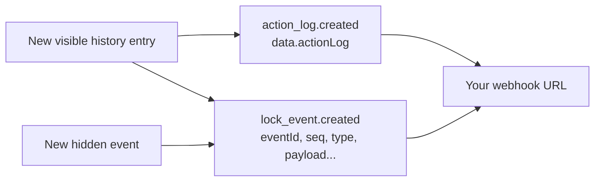

# Webhooks

Webhooks provide a way for Chaster to notify your extension when certain events occur, allowing your extension to take action in response to these events. In this guide, you'll learn how to configure and use webhooks in your Chaster extension.

## What are webhooks?

Webhooks are HTTP callbacks or HTTP POST requests that are triggered by specific events. When an event of interest occurs, Chaster sends an HTTP POST request to a URL that you specify, allowing your extension to receive and process the event data.

Webhooks are useful for various purposes, including:

- Keeping your extension in sync with Chaster data.
- Sending notifications or updates to your extension when specific events occur.
- Triggering actions or workflows in your extension based on Chaster events.

## Why to use webhooks?

Using webhooks in your Chaster extension enables real-time communication between Chaster and your extension, ensuring that your extension can respond to events promptly and accurately. Here are some reasons to use webhooks:

- **Real-time updates**: Webhooks provide instant notifications of events, allowing your extension to react immediately when something happens on Chaster.

- **Automation**: Webhooks enable automation by triggering actions or workflows in your extension in response to Chaster events, reducing manual intervention.

- **Better user experience**: With webhooks, you can provide a more interactive and dynamic experience for Chaster users by delivering timely information and updates.

## Configuring webhooks

To configure webhooks for your Chaster extension, follow these steps:

1. **Access Developer Interface**: Log in to Chaster and access the Developer Interface.

2. **Extension Settings**: Navigate to your extension settings within the Developer Interface.

3. **Extension URLs**: In the Extension URLs section, you'll find options to configure webhooks. Enter the URL where you want to receive webhook notifications for each event type. This URL should be publicly accessible over HTTPS.

   The URL must resolve to a public address: requests to private, loopback, link-local, carrier-grade NAT, multicast or reserved addresses (and their IPv6 equivalents) fail. Chaster does not follow redirects, so a `3xx` response is a failed attempt. Point the URL at the final endpoint.

4. **Basic Authentication**: If you want to protect your webhook URL with basic authentication, you can provide a username and password. We will include these credentials in the HTTP request to your webhook URL. These credentials are required for other extensions to call your commands and queries.

## Handling webhooks

### Responding to a request

When an event occurs, Chaster will send an HTTP POST request to the specified webhook URL. Upon receiving a webhook, your extension should promptly respond with an HTTP status code in the 2xx range (e.g., 200 OK) to acknowledge the receipt of the notification. This response serves as confirmation that your extension has successfully received the event data. Acknowledge only after accepting the event into your durable processing workflow. A 2xx response does not guarantee delivery of later events.

:::info
These rules apply to notifications. `action.invoke` (experimental) is different: it is a call from another extension, and Chaster expects the result of the command in the response, within 10 seconds. It is never retried. See [Handling invocations](/api/extensions-api/extension-communication/handling-invocations).
:::

Chaster adds new event types over time. Read the `event` field first, and answer `2xx` to event types your extension does not handle: any other response triggers retries.

### Request headers

Every notification carries these headers, next to the JSON body:

| Header | Value |
| --- | --- |
| `X-Chaster-Event` | The event name, the same as `event` in the body. |
| `X-Chaster-Event-Id` | The id of the event, the same on every attempt and resend. Search for it with `query` in the [Webhooks API](#webhooks-api); it is not the `deliveryId`. For `lock_event.created`, it is `data.eventId`. For `action_log.created`, it is `data.actionLog._id`. For other events, it is an id Chaster assigns to the delivery. |
| `X-Chaster-Attempt` | `1` on the first attempt, then `2`, `3` and so on. A resend continues the count. |
| `X-Chaster-Request-Id` | New on every attempt, the same as `requestId` in the body. Use it for diagnostics only. |

The body is unchanged. `action.invoke` calls are not notifications: they carry `X-Chaster-Request-Id`, but no `X-Chaster-Event`, `X-Chaster-Event-Id` or `X-Chaster-Attempt`. See [Handling invocations](/api/extensions-api/extension-communication/handling-invocations).

### Deduplicate deliveries

The same event can reach you more than once: after a retry, or when you resend a delivery from the [Webhooks tab](#webhooks-tab). Deduplicate on the pair `X-Chaster-Event` and `X-Chaster-Event-Id`.

`action_log.created` and `lock_event.created` for the same history entry share the same `X-Chaster-Event-Id`. If you receive both and want to react once per history entry, deduplicate on the id alone.

Never deduplicate on `requestId` or `X-Chaster-Request-Id`: they change on every attempt. In the body, the same ids are `data.eventId` for `lock_event.created` and `data.actionLog._id` for `action_log.created`. Other notifications, such as `extension_session.updated`, can legitimately repeat for the same session: each update is its own delivery with its own `X-Chaster-Event-Id`, so do not deduplicate them on the session id.

### Retries

Chaster tries each notification up to 5 times in total. Each attempt waits up to 10 seconds for a response. Retries use exponential backoff starting at 60 seconds (approximately 1, 2, 4 and 8 minutes between attempts).

A `2xx` response delivers the notification. Any other status (including `3xx`), a timeout or a connection error is a failed attempt. Once a delivery is delivered, Chaster sends no further automatic attempt for it.

Each attempt keeps the same `X-Chaster-Event-Id` and gets a new `requestId` and `sentAt`. Retries apply to queued notifications; they do not guarantee that every event is enqueued or delivered.

### Delivery statuses

Each delivery has one of these statuses:

- `delivered`: an attempt got a `2xx` response. This status is final.
- `retrying`: the last attempt failed and another one is scheduled.
- `failed`: the fifth attempt failed, or a test event or resend failed with no retry pending. Chaster gives up.

You can still [resend](#resend-a-delivery) a failed delivery. Test deliveries are `delivered` or `failed`, never retried.

## Webhooks tab

The Developer Interface shows every webhook delivery of your extension. Open the Developer Interface, select your extension, then open the **Webhooks** tab.

- The **Endpoint** card shows your webhook URL, its authentication, `Timeout 10 s`, `5 attempts, exponential from 1 min` and `History kept 7 days`. **Send test event** opens the [test event](#send-a-test-event) dialog.
- The time range (`1 h`, `24 h`, `7 d`) sets the period of the **Attempts**, **Success rate** and **p95 response time** figures, and of the **Delivery attempts** chart. **Retrying now** counts the deliveries retrying at this moment, whatever the range.
- When one event type keeps failing (at least 90% of at least 20 attempts in the last 24 hours, whatever the range), a banner names it and the most common failure. Return `2xx` for event types you ignore, or [unsubscribe](#choose-the-events-you-receive) from them.

The **Deliveries** view lists deliveries, newest first. Filter them by status, event and type, or search by event ID or lock ID. **Live** keeps the list up to date, and **Load older** shows earlier deliveries.

Select a delivery to open its details:

- the attempts timeline, with the next scheduled attempt while it is retrying;
- for each attempt: the request headers (`Authorization` is masked), the payload, the response status, the response body, the duration and the error;
- the related delivery, when `action_log.created` and `lock_event.created` were both sent for the same history entry;
- **Copy as cURL** (without credentials), **Copy payload** and **Resend now**.

The stored response body is the first 4 KB of your response, or the first 512 bytes when an automatic attempt got a `2xx`.

The **Subscriptions** view sets which events your extension receives: see [Choose the events you receive](#choose-the-events-you-receive).

Webhook history is kept for 7 days. If you encounter difficulties, need guidance on webhook implementation, or require help with debugging webhook reception, don't hesitate to reach out to us.

### Resend a delivery

**Resend now** sends a delivery again, once. You can resend any delivery still in the history, except test deliveries: send a new test event instead.

The resend is queued and sends the same `data` and the same `X-Chaster-Event-Id`, with a new `requestId` and `sentAt`. `X-Chaster-Attempt` continues the count of the delivery. A resend repeats an event you may already have processed: deduplicate on the event id.

A failed resend does not stop a retry schedule that is still running, and a delivered delivery stays delivered.

### Send a test event

**Send test event** posts a sample `lock_event.created` or `action_log.created` to your webhook URL. Choose the event and the event type. Optionally, enter the ID of a lock where your extension is installed; otherwise Chaster uses a generated sample lock.

The test is sent immediately, and the dialog shows the response status, duration and body. The envelope has `"test": true` at its root:

```json
{
  "event": "lock_event.created",
  "sentAt": "2030-01-01T12:00:00.000Z",
  "requestId": "synthetic-attempt-01",
  "data": { "...": "sample payload" },
  "test": true
}
```

Answer `2xx` to test events and do not act on them. A test event is never retried, is not counted in the stats, and shows in the **Deliveries** view.

Resends and test events:

- need a webhook URL (`400` with code `webhook-url-missing`);
- are sent only to a webhook URL that resolves to a public address (`400` with code `webhook-target-not-public`);
- are limited to 30 per extension per minute (`429`).

### Choose the events you receive

The **Subscriptions** view controls two settings.

**`action_log.created`** (listed as **Legacy feed**) is on by default. When you turn it off, your extension receives no `action_log.created` for any lock. [Session subscriptions](/api/extensions-api/extension-communication/lock-events#choose-which-events-you-receive) do not affect it, and other events are unchanged.

**Lock event subscriptions** choose the event types your extension receives as `lock_event.created`. They have three states:

- every event except your own (**Receive everything**);
- a list of event types;
- none (an empty list).

Saving applies at once to new events. It does not trigger a manifest review and does not change the manifest revision. The [manifest](/api/extensions-api/extension-communication/manifest#subscriptions) and this view write the same setting: the last write wins. A manifest upload without `subscriptions` keeps it, except the first upload of your extension, which sets an empty list and replaces what you saved here. Event types that are no longer in the event catalog stay listed until you remove them. Sessions can override the extension setting: see [Lock events](/api/extensions-api/extension-communication/lock-events#choose-which-events-you-receive).

## Webhooks API

The Webhooks tab uses these endpoints. They use the same authentication as the other developer endpoints: the developer token, with the `developer` scope (see [Authentication](/api/extensions-api/authentication)).

- `POST /api/developers/extensions/:extensionId/webhooks/deliveries/search`: lists deliveries, newest first. Body: `limit` (1 to 100, default 50), `cursor`, `status` (`delivered`, `retrying` or `failed`), `event`, `eventType`, and `query` (an exact event id or a lock id). Response: `results`, `hasMore` and `nextCursor`.
- `GET /api/developers/extensions/:extensionId/webhooks/deliveries/:deliveryId`: one delivery with its latest 50 attempts, their request headers (`Authorization` masked), payloads and responses, and the related delivery.
- `GET /api/developers/extensions/:extensionId/webhooks/stats?range=24h`: attempts, success rate, durations, hourly series, deliveries retrying now and failing event types. `range` is `1h`, `24h` (default) or `7d`.
- `POST /api/developers/extensions/:extensionId/webhooks/deliveries/:deliveryId/resend`: queues a [resend](#resend-a-delivery) and returns `202` with `{ "deliveryId": "..." }`. A test delivery returns `400` with code `test-delivery`; a delivery whose payload cannot be resent returns `409` with code `payload-unavailable`.
- `POST /api/developers/extensions/:extensionId/webhooks/test`: sends a [test event](#send-a-test-event). Body: `{ "event": "lock_event.created", "type": "...", "lockId": "..." }` (`lockId` optional). Response: `deliveryId`, `eventId`, `statusCode`, `durationMs`, `responseBody` and `error`. An unknown event type returns `400` with code `unknown-event-type`; a lock where your extension is not installed returns `404`.
- `GET /api/developers/extensions/:extensionId/webhooks/subscriptions`: returns `{ "subscriptions": [...], "actionLogFeed": true }` and the event types you can choose, with their volume and success rate over the last 24 hours.
- `PUT /api/developers/extensions/:extensionId/webhooks/subscriptions`: sets `{ "subscriptions": [...], "actionLogFeed": true }`. `subscriptions: null` means every event except your own. Ids use the manifest id format (`invalid-id`, `duplicate-id`), so `"*"` is refused here: send `null` instead.

See the [API reference](https://api.chaster.app/api) for the full schemas.

## Event types

To determine which event types to monitor and configure webhooks for, consider the specific requirements of your extension. Here are the available event types:

- `extension_session.created`: Monitor this event to receive notifications when a new session is created. This can happen when a new lock is created with your extension enabled, or when your extension is enabled on a running lock.
- `extension_session.updated`: Monitor this event to receive notifications when an existing session is updated.
- `extension_session.deleted`: Monitor this event to receive notifications when a session is deleted.
- `peer_verification.ended`: Receive the terminal verdict for a standalone review created by your extension/session, with vote totals and criterion results.
- `action_log.created`: Monitor this event to receive notifications when a new action log entry is created, such as when a lock is unlocked, time is added, etc. You can [turn it off](#choose-the-events-you-receive).
- `lock_event.created` (experimental): Receive the events of the locks where your extension is installed, with their sequence number, type and causation. See [Lock events](/api/extensions-api/extension-communication/lock-events).
- `action.invoke` (experimental): Receive calls from other extensions to your commands and queries, when your manifest has no `invokeUrl`. See [Handling invocations](/api/extensions-api/extension-communication/handling-invocations).

Choose the event types that are relevant to your extension functionality and use cases.

To know exactly the data that is sent with each event type, please refer to the [API documentation](https://api.chaster.app/api) and the model `WebhookEventForPublic`.

## Lock events and action logs

`action_log.created` and `lock_event.created` both carry history entries, and overlap. `lock_event.created` is part of [extension communication](/api/extensions-api/extension-communication/introduction), which is experimental: its payload can change, while `action_log.created` stays stable.



| | `action_log.created` | `lock_event.created` |
| --- | --- | --- |
| Visible history entries | Yes | Yes, depending on subscriptions |
| Hidden events | No | Yes, depending on subscriptions |
| Entries created by your own extension | Yes | No, unless you subscribe to them |
| Fields in `data` | `actionLog` | `eventId`, `sessionId`, `seq`, `type`, `payload`, `source`, `correlationId`, `causationId`, `role`, `user`, `createdAt` |

For the same history entry, `data.eventId` of `lock_event.created` equals `data.actionLog._id` of `action_log.created`, and both deliveries carry the same `X-Chaster-Event-Id`. `lock_event.created` has no `actionLog` and no rendered history text: use `action_log.created` to display history entries.

An extension whose subscriptions are not set (no [manifest](/api/extensions-api/extension-communication/manifest#subscriptions) uploaded yet and no list saved in the Webhooks tab, `subscriptions: ["*"]` in its manifest, or **Receive everything** in the [Webhooks tab](#choose-the-events-you-receive)) and no session subscription list receives `lock_event.created` for every event of the lock, except the events it created itself. A visible history entry then reaches it twice, once per event type.

:::warning
If your handler does not check `event`, it reacts twice to each visible history entry, once per event type, and also reacts to hidden events.

**To react once per history entry**, handle only `action_log.created`. When `event` is `lock_event.created`, answer `2xx` and do nothing else.
:::

To move to `lock_event.created` instead, knowing its payload can still change:

1. Choose the event types you need, in the `subscriptions` of your [manifest](/api/extensions-api/extension-communication/manifest#subscriptions) or in the [Subscriptions view](#choose-the-events-you-receive). Untyped entries such as custom logs are then no longer delivered as lock events.
2. Read `role`, `user` and `createdAt` at the top level of `data`: the fields of the event itself are in `payload`.
3. Turn `action_log.created` off in the Subscriptions view, or keep it and deduplicate on `X-Chaster-Event-Id`.
4. If you changed the subscriptions of a session, they override the extension setting for that session.


## Peer review verdicts

After a [standalone peer review](/api/extensions-api/create-your-extension/peer-verifications) completes through normal verdict processing, Chaster sends `peer_verification.ended` to the creating partner's configured callback URL. The payload identifies the creating session. Other extensions on the same lock do not receive it. Configure HTTPS and the existing basic authentication settings, and validate those credentials in your handler.

This complete synthetic envelope shows a rejected review:

```json
{
  "event": "peer_verification.ended",
  "sentAt": "2030-01-01T12:15:01.000Z",
  "requestId": "synthetic-attempt-01",
  "data": {
    "sessionId": "synthetic-session-01",
    "extension": {
      "slug": "synthetic-extension"
    },
    "lockId": "000000000000000000000401",
    "peerVerificationId": "000000000000000000000301",
    "verificationTypeKey": "photo",
    "status": "rejected",
    "endedAt": "2030-01-01T12:15:00.000Z",
    "voteCounts": {
      "verified": 2,
      "rejected": 1
    },
    "checkResults": [
      {
        "checkId": "seal-intact",
        "name": "generic",
        "checkIndex": 0,
        "subcheckName": "generic",
        "nbVerifiedVotes": 3,
        "nbRejectedVotes": 0,
        "rejectionReasons": []
      },
      {
        "checkId": "date-visible",
        "name": "generic",
        "checkIndex": 1,
        "subcheckName": "generic",
        "nbVerifiedVotes": 2,
        "nbRejectedVotes": 1,
        "rejectionReasons": [
          {
            "slug": "unclear",
            "text": "The date is unclear.",
            "nbVotes": 1
          }
        ]
      }
    ]
  }
}
```

`status` is `verified` or `rejected`. `endedAt` is the stored verdict time; `sentAt` is the time of this delivery attempt. `requestId` also changes on retry, so use it for attempt diagnostics, not business deduplication. The payload contains no image bytes, private URLs, attachment tokens or voter identities.

Deduplicate your durable partner work by `(data.peerVerificationId, event)`, for example `000000000000000000000301:peer_verification.ended`. After authenticating and validating the envelope, atomically accept that key and payload into your own durable inbox, then return a prompt 2xx acknowledgment. Process accepted work once according to your own storage/worker guarantees. Duplicate deliveries should receive a successful acknowledgment without repeating your business work. Do not mark work complete before it is durably accepted.

`checkResults` preserves `checkId`, family `name`, `checkIndex` and `subcheckName`, plus `nbVerifiedVotes`, `nbRejectedVotes` and reason `nbVotes`. This differs from history's criterion `approved`, `rejected` and reason `count` fields. Identical reason slugs in different criteria remain separate through `checkId` and stored reason text. No per-check verdict is supplied. A zero-vote timeout can report `status: "verified"` with zero vote and criterion totals.

### Actions and delivery limits

Chaster stores the terminal verdict first. On rejection, it then runs the snapshotted `punishments` sequentially before emitting the verdict event. Your handler must not replay those lock actions. No native Penalties extension is required.

An action failure or interruption can leave only part of the action list applied and prevent the callback from being enqueued. There is no added action recovery or exactly-once delivery guarantee. Do not infer that all actions ran merely because history contains a terminal verdict.

Lock-end bulk closure runs no rejection actions and emits no verdict callback. A callback already queued, or one being retried, may still arrive after the lock ends or its session is deleted. Tolerate this race: process from the saved review ID and payload without blindly fetching or modifying a deleted session. If session access is needed, handle a missing session explicitly.

[Session review history](/api/extensions-api/create-your-extension/peer-verifications#search-all-session-history) is an inspection fallback while the session exists. It does not repair delivery or prove exactly which actions completed.
