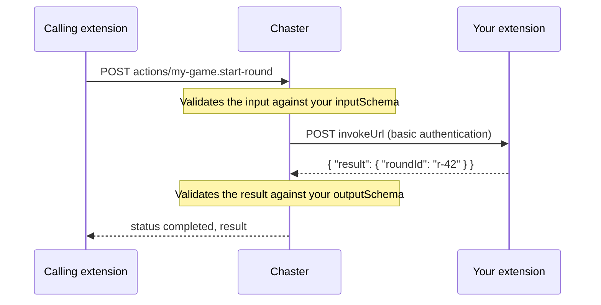

:::caution[Experimental]
Extension communication is experimental. The manifest, commands, queries, lock events, endpoints and webhooks can change in incompatible ways or be removed. Changes are listed in the [API changelog](/api/changelog).
:::

When another extension calls one of your commands or queries, Chaster forwards the call to your extension and waits for your answer.

## Introduction

To receive calls, your extension needs:

- A [manifest](/api/extensions-api/extension-communication/manifest) declaring the command or query, with `extension` in its `invocableBy`.
- A webhook username and password in your extension settings. Chaster sends them with HTTP basic authentication on every call: check them before running anything.
- An `invokeUrl` in your manifest, or a webhook URL.

Chaster validates the input against your `inputSchema` and checks availability and rate limits before calling you, so the input you receive always matches your schema.



## The request

Chaster sends a `POST` request with these headers:

- `Authorization`: basic authentication with your webhook credentials.
- `X-Chaster-Request-Id`: a unique id for this request.
- `X-Chaster-Invocation-Id`: the id of the invocation.

With an `invokeUrl`, the body is the invocation itself:

```json
{
  "invocationId": "6731b2d0e5f0a1b2c3d4e5f7",
  "commandId": "my-game.start-round",
  "capability": "command",
  "sessionId": "your-session-id",
  "input": { "difficulty": "hard" },
  "actor": "extension",
  "caller": {
    "extensionId": "6731a0000000000000000001",
    "slug": "rules-engine",
    "displayName": "Rules engine"
  },
  "causationId": "6731b2c4e5f0a1b2c3d4e5f6",
  "correlationId": "6731b2c4e5f0a1b2c3d4e5f6",
  "depth": 1,
  "schemaVersion": 3
}
```

`sessionId` is the id of your own session on the lock. `capability` is `command` or `query`. `schemaVersion` is the revision of your manifest the input was validated against.

Without an `invokeUrl`, Chaster sends the same object to your webhook URL, wrapped in a webhook envelope:

```json
{
  "event": "action.invoke",
  "sentAt": "2026-11-04T12:00:00.000Z",
  "requestId": "V1StGXR8_Z5jdHi6B-myT",
  "data": { "invocationId": "...", "commandId": "..." }
}
```

## Your response

Answer within 10 seconds. Chaster does not follow redirects, and reads at most 64 KiB of response.

| Your response                                                   | Invocation status |
| --------------------------------------------------------------- | ----------------- |
| `2xx` with `{ "result": { ... } }` matching your `outputSchema` | `completed`       |
| `2xx` without a `result` object, or not matching `outputSchema` | `unknown`         |
| `4xx` with `{ "error": { "code": "...", "message": "..." } }`   | `rejected`        |
| Any other `4xx` or `5xx`                                        | `failed`          |
| No answer within 10 seconds                                     | `unknown`         |
| Endpoint unreachable                                            | `failed`          |

Use `rejected` for business refusals the caller can act on, such as `round-already-running`. `code` is kebab-case, up to 60 characters. `message` is up to 500 characters.

```json
{
  "error": {
    "code": "round-already-running",
    "message": "A round is already running."
  }
}
```

:::info
Chaster sends each invocation once and never retries it. Use `invocationId` to make your handler idempotent.
:::

Chaster limits how many calls to your extension run at the same time. Above that limit, callers receive `503 partner-busy` and can retry after one second.

## Act on the lock from a handler

While handling an invocation, your extension can call other commands or emit events. Pass the `invocationId` as `causationId` so Chaster links them to the call that caused them.
