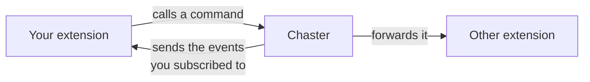
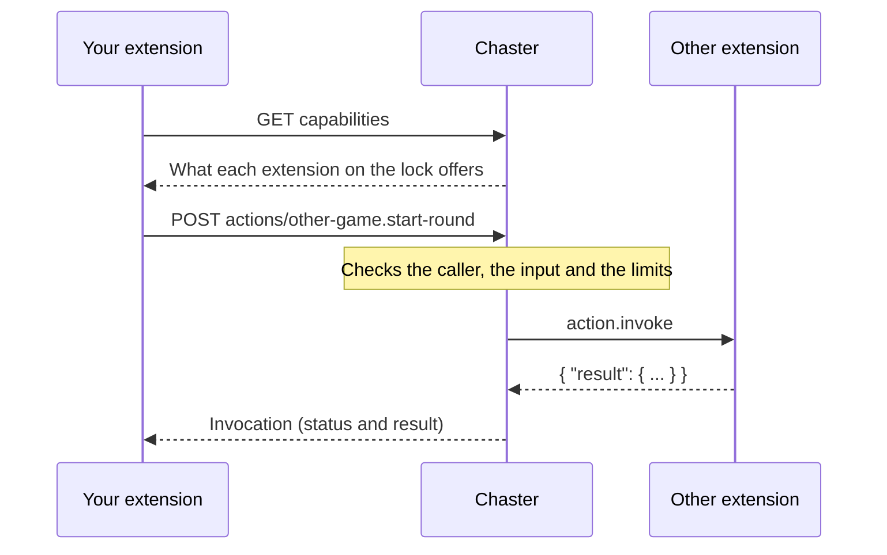

With extension communication, your extension can work together with the other extensions on a lock, including ones you have never heard of: add time, assign a task, react when the wearer rolls the dice, or let other extensions drive yours.

## Introduction

A lock often runs several extensions at once. Without extension communication, each one lives in its own bubble: a game extension cannot assign a task, and a rules engine cannot react to a Wheel of Fortune result unless both were written by the same developer.

Extension communication solves this with three ideas:

1. **Extensions describe what they can do.** A **manifest** lists the commands, queries and events of an extension, with a JSON Schema (a standard JSON format that describes the shape of data) for every input and output. Chaster provides them for the lock itself and its own extensions (Tasks, Penalties, Pillory, Dice, Wheel of Fortune...). Your extension can call these commands and receive events without a manifest. You publish one only when you want other extensions to call your extension or subscribe to your events.
2. **Chaster is the middleman.** Extensions never call each other directly. Your extension asks Chaster to run a command on the lock, Chaster checks it, forwards it to the extension that owns it and records the outcome.
3. **Every lock has one ordered stream of events.** Each entry in the lock history, from any extension or from Chaster, is an event with a sequence number. Your extension receives the events it subscribed to by webhook, and can read the stream again at any time.

Nothing is hardcoded: your extension discovers at runtime what the other extensions on the lock offer, so it keeps working when a new extension appears.

## Vocabulary

| Term          | Meaning                                                                                                      |
| ------------- | ------------------------------------------------------------------------------------------------------------ |
| Manifest      | The public description of an extension: its commands, queries and events.                                    |
| Command       | Something an extension can be asked to do, which changes the lock. Example: `lock.add-time`, `tasks.assign`. |
| Query         | Something an extension can be asked to answer, without changing anything. Example: `pillory.status`.         |
| Event         | Something that happened on the lock. Example: `dice.rolled`, `wheel-of-fortune.landed`.                      |
| Capability id | The name of a command, query or event: `<extension slug>.<name>`. The `lock` namespace belongs to Chaster.   |
| Invocation    | One call to a command or query, with its status and result.                                                  |
| Causation     | The link between a call and the event that caused it. Calls that follow each other share a `correlationId`.  |

## How it works

1. Your extension reads the [capabilities](/api/extensions-api/extension-communication/calling-extensions#discover-what-a-lock-offers) of the lock: every installed extension with its commands, queries and events, and whether each one is available right now.
2. It [calls a command or a query](/api/extensions-api/extension-communication/calling-extensions#call-a-command-or-a-query). Chaster validates the input against the JSON Schema, checks who may call it and applies rate limits.
3. Built-in commands run inside Chaster. Commands of another partner extension are forwarded to it as an [`action.invoke` request](/api/extensions-api/extension-communication/handling-invocations).
4. Separately, everything written to the lock history (time added, a task assigned by Tasks, a dice roll, an event an extension emits) is delivered to subscribed extensions as a [`lock_event.created` webhook](/api/extensions-api/extension-communication/lock-events). A partner command does not write to the history by itself: the extension that runs it emits its own events if it wants to.

## Example: a wheel that assigns a task

You build an extension that assigns a task each time the Wheel of Fortune lands.

1. Your extension subscribes to `wheel-of-fortune.landed`.
2. The wearer spins the wheel. Your webhook receives a `lock_event.created` with `type: "wheel-of-fortune.landed"` and the landed segment in `payload`.
3. Your extension calls `POST /api/extensions/sessions/:sessionId/actions/tasks.assign` and passes the event id as `causationId`.
4. Tasks assigns the task and announces `tasks.assigned`. Your invocation records the wheel spin as its `causationId`, so the chain can be traced from the spin to the task.

## What you can do

- **Call other extensions**: read the lock capabilities and run commands or queries. See [Calling extensions](/api/extensions-api/extension-communication/calling-extensions).
- **Listen to the lock**: subscribe to events and read the event stream. See [Lock events](/api/extensions-api/extension-communication/lock-events).
- **Let other extensions use yours**: publish a [manifest](/api/extensions-api/extension-communication/manifest) and [answer invocations](/api/extensions-api/extension-communication/handling-invocations).
- **Announce your own events**: emit typed events that other extensions can subscribe to. See [Emit an event](/api/extensions-api/extension-communication/lock-events#emit-an-event).

The manifest of any published extension is available without authentication at `GET /api/extensions/:slug/manifest`.

:::info
All requests in this section use your developer token, like the rest of the Extensions API. See [Authentication](/api/extensions-api/authentication). Errors and rate limits are listed in [Errors and limits](/api/extensions-api/extension-communication/errors-and-limits).
:::
