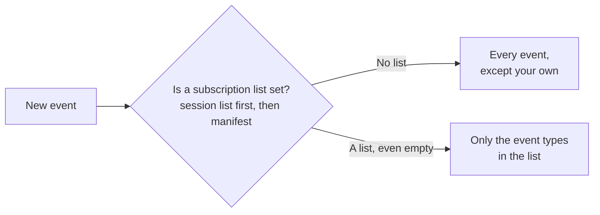

:::caution[Experimental]
Extension communication is experimental. The manifest, commands, queries, lock events, endpoints and webhooks can change in incompatible ways or be removed. Changes are listed in the [API changelog](/api/changelog).
:::

Every lock has one ordered stream of events. Your extension can receive these events by webhook, read the stream again, and add its own events to it.

## Introduction

Each entry written to the lock history is an event: time added by the keyholder, a dice roll, a task completed, a custom log from an extension. Each event has:

- An `eventId`, the id of the history entry.
- A `seq` number, which increases by one each time an event is written on the lock. Use it to put events in order. The events you receive can skip numbers because of your subscriptions, a `types` filter or expired hidden events, so a gap does not always mean a delivery failed.
- A `type`, the capability id of the event (`dice.rolled`, `lock.time-changed`), or `null` when the entry has no declared schema, such as a custom log.

Some events are **hidden**: they are part of the stream but never shown in the lock history or in notifications. For example, `lock.capabilities-changed` and `link.voted` are hidden. Hidden events are kept for 30 days.

## Receive events

Chaster sends a `lock_event.created` webhook to your webhook URL for each event on a lock where your extension is installed:

```json
{
  "event": "lock_event.created",
  "sentAt": "2026-11-04T12:00:01.000Z",
  "requestId": "V1StGXR8_Z5jdHi6B-myT",
  "data": {
    "sessionId": "your-session-id",
    "eventId": "6731b2c4e5f0a1b2c3d4e5f6",
    "seq": 42,
    "type": "dice.rolled",
    "source": null,
    "payload": { "...": "..." },
    "correlationId": null,
    "causationId": null,
    "actionLog": {
      "_id": "6731b2c4e5f0a1b2c3d4e5f6",
      "type": "dice_rolled",
      "...": "..."
    }
  }
}
```

| Field           | Description                                                                                                                                  |
| --------------- | -------------------------------------------------------------------------------------------------------------------------------------------- |
| `sessionId`     | Your session on the lock.                                                                                                                    |
| `eventId`       | Stable id of the event. Equal to `actionLog._id`.                                                                                            |
| `seq`           | Position of the event in the lock stream.                                                                                                    |
| `type`          | Capability id of the event, or `null`.                                                                                                       |
| `source`        | The extension that created the event: `{ "extensionId", "invocationId" }`, or `null`.                                                        |
| `payload`       | The event data, matching the `payloadSchema` of the event. Always an object.                                                                 |
| `correlationId` | The chain the event belongs to, or `null`.                                                                                                   |
| `causationId`   | The event or invocation that caused this event, or `null`.                                                                                   |
| `actionLog`     | The history entry, in the same format as the [`action_log.created`](/api/extensions-api/create-your-extension/webhooks#event-types) webhook. |

### Choose which events you receive

Which events your extension receives depends on its subscriptions:



- **No subscriptions** (no manifest and no session list): receives every event of the lock, typed or not, visible or hidden, except the events created by your own extension.
- **Extension with a manifest**: receives only the event types listed in the `subscriptions` of its [manifest](/api/extensions-api/extension-communication/manifest#subscriptions). Untyped events (`type: null`) are never delivered. An empty list delivers nothing.
- **Per session**: `PUT /api/extensions/sessions/:sessionId/subscriptions` with `{ "subscriptions": ["dice.rolled"] }` replaces the list for one session (up to 100 ids). Send `{ "subscriptions": null }` to go back to the list of the manifest.

Your extension never receives its own `lock.capabilities-changed`.

:::warning
`lock_event.created` and `action_log.created` overlap. A visible history entry is sent in both, with the same `actionLog._id`. If your extension handles `action_log.created`, the safe option is to answer `2xx` to `lock_event.created` and ignore it. Subscriptions only filter `lock_event.created`: if you subscribe to an event type, ignore `action_log.created` or deduplicate on `actionLog._id`. See [Webhooks](/api/extensions-api/create-your-extension/webhooks#lock-events-and-action-logs).
:::

### Delivery

- Webhook delivery can fail or repeat. Deduplicate on `eventId`: retries keep the same `eventId` and get a new `requestId`.
- Chaster skips deliveries it already recorded as successful (`2xx`) for your extension.
- Failed deliveries are retried like other [webhooks](/api/extensions-api/create-your-extension/webhooks#retries): up to 5 attempts, with exponential backoff starting at 60 seconds.
- Events can arrive out of order. Order them by `seq`, and use the [event stream](#read-the-event-stream) to recover events your endpoint missed.

Webhook payloads use the keyholder view of the lock: durations are included even when the lock hides time from the wearer.

## Read the event stream

- `GET /api/extensions/sessions/:sessionId/events`: read the events of the lock in `seq` order.

| Parameter  | Description                                                          |
| ---------- | -------------------------------------------------------------------- |
| `afterSeq` | Return events with a `seq` greater than this value. Defaults to `0`. |
| `types`    | Optional comma-separated list of event types, up to 50.              |
| `limit`    | Between 1 and 200. Defaults to 50.                                   |

The response is `{ "events": [...], "hasMore": true }`, with events in the same format as the `data` of `lock_event.created` (without `sessionId`). Keep the last `seq` you processed and call again with `afterSeq` while `hasMore` is `true`.

Events written in the last 5 seconds are held back, and `hasMore` is `true` while they are. The stream includes hidden events.

This endpoint also accepts the main page token of your iframe in the `X-Chaster-Main-Token` header. When the reader is the wearer and the lock hides time, durations are removed from payloads.

:::info
`seq` exists on events written since 2026-10-19. Older history entries are not part of the stream.
:::

## Emit an event

Your extension can add typed events to the stream, which other extensions can subscribe to:

- `POST /api/extensions/sessions/:sessionId/events`

```json
{
  "type": "my-game.round-won",
  "payload": { "score": 12 },
  "visibility": "visible",
  "causationId": "6731b2d0e5f0a1b2c3d4e5f7"
}
```

- `type` must be an event declared in your manifest, in your own namespace.
- `payload` is validated against the `payloadSchema` of the event.
- `visibility` is `visible` (default) or `hidden`. A visible event appears in the lock history, rendered with the template of your log type. A hidden event is only part of the stream.
- `causationId` is optional and follows the same rules as [calls](/api/extensions-api/extension-communication/calling-extensions#causation-and-correlation).

The response contains the `eventId`, `seq`, `type`, `visibility`, `correlationId`, `causationId`, `depth`, `causationInferred` and `createdAt` of the new event. Emitting events counts toward the [rate limits](/api/extensions-api/extension-communication/errors-and-limits#rate-limits).

[Custom logs](/api/extensions-api/create-your-extension/custom-logs) are untyped events: they reach extensions without a manifest, but never match a subscription.
